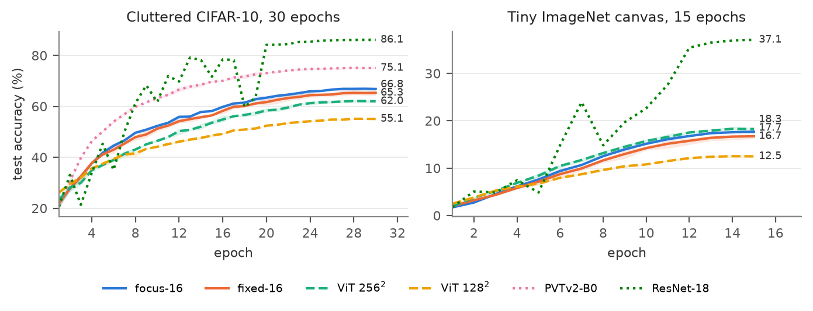

# Partition RART: Anchors That Move Without Collapsing

Research code for a Vision Transformer whose global communication runs through a small set of
**anchor tokens with exclusive regions**. Every patch belongs to exactly one anchor, so two
anchors can never summarise the same patches. On top of that partition, **focus anchors** move
to the parts of the image a learned importance map marks as relevant, while the partition stays
exclusive.

**Paper:** [Anchors That Move Without Collapsing: Exclusive-Region Anchor Routing for Vision
Transformers](https://arxiv.org/abs/2611.27855) (arXiv:2611.27855). The LaTeX source is in
[`paper_tmlr/`](paper_tmlr/). All experiments, logs and result files are in
[`experiments/`](experiments/).

```bibtex
@misc{anchors2026,
  title         = {Anchors That Move Without Collapsing: Exclusive-Region Anchor Routing for Vision Transformers},
  author        = {Gupta, Aadi},
  year          = {2026},
  eprint        = {2611.27855},
  archivePrefix = {arXiv},
  primaryClass  = {cs.CV}
}
```

**Status:** preprint ([arXiv:2611.27855](https://arxiv.org/abs/2611.27855)). All models are
trained from scratch at small scale, on CIFAR-100, cluttered CIFAR-10 and Tiny ImageNet canvases,
Megapixel MNIST and full-HD DFG traffic-sign scenes. The results study how anchors route global
information, not state-of-the-art accuracy; a ResNet-18 is more accurate on every task.

---

## Summary of findings

1. **Soft anchor pathways collapse or stay redundant.** On one shared backbone, RART- and
   AnchorFormer-style anchors learn nearly identical pooling maps (map similarity 0.998 and
   0.990), AnchorFormer despite implementing its mass normalisation. The other soft pathways,
   including a faithful reimplementation of Representative Attention, stay only partly diverse
   (0.59–0.79); no single design choice explains which group a pathway falls in. The exclusive
   partition cannot collapse by construction.
2. **Matched component by component, the exclusive partition is the most accurate anchor
   pathway.** Representative Attention's lead over the plain partition (+1.2 points on CIFAR-100)
   comes from its 3×3 depth-wise convolution bypass: with the same convolution on both, the
   partition is ahead by 2.4 points (95% CI [0.9, 3.9]).
3. **Focus anchors beat the fixed partition where content is sparse.** On a cluttered 256²
   CIFAR-10 canvas trained for 30 epochs, focus-16 reaches 66.82 ± 0.66% against 65.29 ± 0.94%
   (paired +1.54, 95% CI [0.53, 2.55], 3 of 3 seeds). On Megapixel MNIST and full-HD traffic signs
   the two are not distinguishable.
4. **Anchors keep full resolution at a fraction of the cost of dense attention.** On DFG traffic
   signs at 1920×1080, a ViT on a 480-wide input loses half its mAP (15.8 against about 30), while
   focus and fixed anchors match dense attention with the same local windows (30.3 and 29.6
   against 30.3) at about a fifth of its FLOPs.
5. **Hard exclusive assignment is what makes moving anchors trainable.** Softmax relaxation and
   Sinkhorn balancing diverge; Gumbel-softmax trains in 2 of 3 seeds but is 2.5–4.3 points worse.
6. **The limits are real.** ResNet-18 is the best model on every task in this from-scratch
   regime. Dense attention with local windows beats the anchors on the Tiny ImageNet canvas.
   Anchors train faster than FlashAttention only from about 1536² (fixed) or 2048² (focus), and
   never use less memory. Focus anchors became unstable in 1 of 3 seeds at learning rate 2e-4
   (stable at 1e-4).

---

## Method

### One block: local, global through anchors, local

```text
patches -> local window attention
        -> gather: each anchor pools the patches of its own region      (N -> A)
        -> anchor self-attention                                        (A x A)
        -> scatter: each patch reads back from its own anchor           (A -> N)
        -> FFN
```

The dense N × N attention of a ViT is replaced by A × A attention among anchors. At 224² with
16 anchors, that is 196 + 16² = 452 global interactions instead of 196² = 38,416. This is an
interaction count, not a wall-clock speedup.

### Exclusive regions

Each patch is assigned to its nearest anchor, which splits the patch grid into Voronoi regions.
The forward pass uses this hard assignment. Gradients reach the anchor positions through a
straight-through softmax over distances. Anchors pool only inside their region. The pooling
denominator is clamped at 1, which only affects empty regions. An epsilon clamp produced
gradients of order 10⁹ when two moving anchors met.

With anchors fixed on a grid, the block is **Partition RART** (`fixed`).

### Focus anchors

A linear head scores every patch. In each block:

* **Coverage anchors.** A quarter of the anchors stay on a coarse fixed grid (4 of 16), so every
  part of the image keeps a summary.
* **Focus anchors.** The rest are placed one at a time at the soft-argmax of the scores. After
  each placement, the scores around it are suppressed (strength β = 10, width σ_s = 1.5 patches),
  so that the next anchor goes elsewhere. A weak prior towards spread-out home positions
  (σ_h = 0.35) breaks ties early in training.
* **Importance in pooling.** Gather logits are offset by the log-importance. This trains the
  importance head from the classification loss alone.

All anchors share one Voronoi partition. Focus anchors can crowd onto the object, which makes
their regions small, but they never share a patch.

---

## Results

### Main comparison (experiment 06)

Mean ± std over seeds 42/43/44. In **Cluttered CIFAR-10**, a CIFAR-10 image (upscaled to 64 px)
sits at a random position on a 256² canvas among distractor crops. In the **Tiny ImageNet
canvas**, a 64 px Tiny ImageNet image is pasted at native resolution among 32 px crops
(200 classes).

| Model | Params | GFLOPs | Cluttered, 30 ep | Tiny ImageNet, 15 ep |
|---|---:|---:|---:|---:|
| focus-16 | 11.4M | 5.49 | **66.82 ± 0.66** | 17.68 ± 0.33 |
| focus-4 | 11.4M | 5.45 | 64.67 ± 0.26 | – |
| fixed-16 (Partition RART) | 11.4M | 5.49 | 65.29 ± 0.94 | 16.73 ± 0.46 |
| Dense attention with local windows | 12.8M | 7.25 | 65.10 ± 0.45 | **20.50 ± 0.29** |
| ViT, 256² input | 9.3M | 5.28 | 61.99 ± 0.54 | 18.25 ± 0.33 |
| ViT, 128² input | 9.2M | 1.21 | 55.05 ± 0.26 | 12.49 ± 0.28 |
| PVTv2-B0 | 3.4M | 1.51 | 75.07 ± 0.25 | – |
| ResNet-18 (lr 1e-3) | 11.2M | 4.74 | 86.11 ± 0.26 | 37.07 ± 0.28 |

| Paired gap (95% CI) | Cluttered, 30 ep | Tiny ImageNet, 15 ep |
|---|---:|---:|
| focus-16 − fixed-16 | +1.54 [+0.53, +2.55] | +0.95 [−0.93, +2.83] |
| focus-16 − ViT 256² | +4.83 [+3.86, +5.80] | −0.58 [−2.11, +0.95] |
| focus-16 − ViT 128² | +11.77 [+9.73, +13.82] | +5.19 [+4.43, +5.95] |
| focus-16 − dense with windows | +1.72 [−0.80, +4.25] | −2.82 [−3.99, −1.66] |



Dense attention with the same local windows closes most of the anchors' lead over the plain
dense ViT on Cluttered CIFAR-10, and is the best transformer on the Tiny ImageNet canvas.

### Anchor collapse (experiment 03)

Six anchor designs on one shared backbone (CIFAR-100, 224², 10 epochs, 3 seeds). AnchorFormer
and Representative Attention have no public code and are implemented from their papers,
including their mass-normalisation stabilisers:

* The RART-style and AnchorFormer pathways collapse to a single summary: pooling-map
  similarity 0.998 and 0.990.
* The competitive, PaCa-style and Representative Attention pathways are only partly diverse
  (0.59–0.79) and grow more similar with depth. AnchorFormer and Representative Attention route
  almost identically (learned prototypes, softmax over them, mass normalisation) and differ after
  gathering; we have not isolated which difference keeps the latter from collapsing.
* The fixed partition has zero map overlap by construction. Representative Attention is 1.2
  points more accurate than the plain partition (47.54 against 46.31), but only because of its
  3×3 depth-wise convolution: with the same convolution added to both, the partition leads by
  2.4 points (49.93 against 47.54, 95% CI [0.9, 3.9]); without it on both, by 3.6.

### Ablations and sensitivity (experiment 06, focus-16, 10 epochs)

| Variant | Accuracy (%) | Note |
|---|---:|---|
| Full model, clip + warmup | 53.78 ± 0.09 | reference |
| No suppression, clip + warmup | 53.57 ± 0.43 | −0.21 [−1.51, +1.08]; one seed diverged without clipping |
| No home prior (no clipping) | 47.23 ± 1.17 | −2.6 against 49.84 |
| No coverage grid / 3×3 grid (no clipping) | 49.63 / 49.40 | no measurable effect |
| Soft assignment, clip + warmup | 10.00 × 3 | diverged in every seed |
| Soft + Sinkhorn balancing, clip + warmup | 9.98 / 10.00 / 12.44 | peaked at 26–39%, then diverged |
| Soft Gumbel-softmax, annealed, clip + warmup | 22.08 / 49.53 / 51.30 | seed 42 diverged at epoch 9 |
| Read from the 3 nearest anchors, clip + warmup | 54.61 ± 0.55 | +0.83 [−0.55, +2.20] |

Placement is robust near its defaults. In one seed per setting, β = 3, σ_s = 0.75 and
σ_h ∈ {0.15, 1.0} all stay within 1.5 points of the reference. It breaks when suppression is
much stronger (β = 30: −4.4 points) or much wider (σ_s = 3 patches: stalls near 20%).

### Compute skipping (experiments 05 and 06)

Letting 75% of patches skip the FFN in blocks 3–6 cuts compute by 25% (5.31 → 3.96 GFLOPs).
Random selection costs only 0.38 points (53.40 ± 0.35%, clip + warmup). Selection by the learned
importance map is not better than random or token-norm selection, and a bounded
straight-through importance gate diverges.

### High resolution (experiment 07)

**DFG traffic signs**, 1920×1080 street scenes, recognising the 20 most frequent sign types
(multi-label mAP, 3 seeds, max-pooled heads; with average pooling every model, including a
pretrained ResNet-18, stayed near chance):

| Model | Test mAP | GFLOPs |
|---|---:|---:|
| ResNet-18 | 36.51 ± 1.65 | 160 |
| focus-64 | 30.28 ± 0.88 | 187 |
| Dense attention with local windows | 30.28 ± 0.85 | 912 |
| fixed-64 | 29.62 ± 0.20 | 187 |
| Dense ViT, full HD | 28.60 ± 0.64 | 846 |
| PVTv2-B0 | 19.50 ± 1.75 | 195 |
| ViT, 480-wide input | 15.80 ± 0.67 | 13 |

**Megapixel MNIST** at 512² (five 28 px digits among noise): fixed-64 91.87 ± 0.35, dense with
windows 91.40 ± 0.20, dense ViT 86.10 ± 0.96, ViT on 256² 93.37 ± 2.40, ResNet-18 99.30 ± 0.26.

### Cost

At 256², measured on an A100 (bf16, batch 128):

| Model | Train step | Peak train memory | Inference |
|---|---:|---:|---:|
| ViT 256² | 32.4 ms | 3,111 MB | 11,176 img/s |
| fixed-16 | 60.7 ms | 4,314 MB | 6,408 img/s |
| focus-16 | 99.3 ms | 4,528 MB | 5,259 img/s |

The sequential placement of focus anchors adds about 3–4 ms per focus anchor per step.

At high resolution, against a dense ViT with FlashAttention (experiment 07, training step at
batch 8): fixed anchors are 1.5× faster at full HD and 2.3× faster at 2048², focus anchors only
at 2048². The anchor models always use more training memory than FlashAttention (18.5–20.2 GB
against 11.1 GB at 2048²). Experiment 02's large memory advantage holds only against attention
without a fused kernel, which runs out of memory from 1536² at batch 8.

### Early experiments (01–02)

On CIFAR-100 at 224² (10 epochs, 1 seed), Partition RART reached 44.62%, against 45.44% for a
ViT. Unrestricted anchors (RART-16/32) reached 42.21% and 39.73%. Their anchors collapsed:
pairwise similarity 0.99, and each anchor attended to 194.8 of 196 patches. These results
motivated experiments 03–06. Details are in [`docs/research_summary.md`](docs/research_summary.md).

---

## Limitations

* The tasks are small and synthetic, and all models are trained from scratch for 10–30 epochs.
  Absolute accuracy is low, and a CNN and PVTv2 are far ahead.
* Three seeds give wide confidence intervals, and some skipping rows and the sensitivity sweep
  use one or two seeds.
* Experiments 03–06 have no validation split, and their 30-epoch learning rate was chosen on test
  accuracy; experiment 07 uses validation splits and fixed settings.
* AnchorFormer and Representative Attention are implemented from their papers (no public code),
  used as the global pathway of our block rather than as full published models. The PaCa-style
  model is simplified.
* Focus anchors became unstable in 1 of 3 seeds on Megapixel MNIST at learning rate 2e-4
  (reproducibly; stable at 1e-4).
* The importance map marks content in general rather than the class object.
* The implementation is not optimised: below about 1536² it is slower than dense attention with
  FlashAttention, and it never uses less memory.

---

## Related work

Anchor-based token bottlenecks are not new. The closest prior work for each component:

* **Fixed regional tokens:** [RegionViT](https://arxiv.org/abs/2106.02689) associates each
  regional token with a fixed group of local tokens, close to the fixed partition here.
* **Anchor bottlenecks (gather, interact, distribute):**
  [AnchorFormer](https://arxiv.org/abs/2505.16463), [LeMeViT](https://arxiv.org/abs/2405.09789),
  [PaCa-ViT](https://arxiv.org/abs/2203.11987),
  [Representative Attention](https://arxiv.org/abs/2605.14913).
* **Content-driven regions:** [SViT super tokens](https://arxiv.org/abs/2211.11167),
  [SALG](https://arxiv.org/abs/2211.14705), [TCFormer / FTCFormer](https://arxiv.org/abs/2507.10283).
* **Learned movement towards important regions:** [DAT](https://arxiv.org/abs/2201.00520),
  [PS-ViT](https://arxiv.org/abs/2108.01684).
* **High-resolution recognition under a memory budget:**
  [Differentiable Patch Selection](https://arxiv.org/abs/2104.03059),
  [Iterative Patch Selection](https://arxiv.org/abs/2210.13007).

What this project contributes is the combination: an exclusive partition that prevents collapse
by construction, anchors that move to content without giving it up, and a controlled
comparison of collapse across anchor designs.

---

## Repository layout

```text
README.md                        this overview
docs/research_summary.md         detailed log of experiments 01–02
experiments/
  README.md                      index of all experiments and how to run them
  01_partition_rart/             ViT, RART, Local-Global-Local and Partition RART on CIFAR-100
  02_resolution_scaling/         latency and memory from 224² to 2048², efficient baselines
  03_anchor_collapse/            anchor collapse across five anchor designs
  04_moving_anchors/             fixed, moving and focus anchors on Cluttered CIFAR-10
  05_compute_skipping/           FFN skipping guided by the learned importance map
  06_main_comparison/            baselines, 30-epoch and Tiny ImageNet runs, ablations, cost
paper/                           LNCS paper draft (main.tex, refs.bib, figures/)
```

Each experiment folder has a README covering the question, setup, results and findings, plus its
code or notebook and a `results/` folder. Model checkpoints are not committed.

## Reproducing

* **Experiments 01–02:** Kaggle notebooks (PyTorch 2.10, CUDA 12.8, Tesla T4).
* **Experiments 03–05:** notebooks that run on Kaggle or locally (PyTorch 2.11, RTX 5060 Laptop
  GPU). They download CIFAR if it is not found under `/kaggle/input`.
* **Experiment 06:** `train.py` and `run_suite.py`, configured through `RART_*` environment
  variables. These were run on a rented A100-80GB in bf16, with phase V on the laptop GPU.

Settings and commands for each experiment are in [`experiments/README.md`](experiments/README.md)
and [`experiments/06_main_comparison/README.md`](experiments/06_main_comparison/README.md).

---

## Roadmap

* [x] ViT baseline, unrestricted anchors, Local-Global-Local and Partition RART (01)
* [x] Resolution scaling to 2048² against dense and efficient transformers (02)
* [x] Anchor collapse across five designs, 3 seeds, with a dense reference (03)
* [x] Moving and focus anchors on Cluttered CIFAR-10, 3 seeds (04)
* [x] Compute skipping against random and token-norm selection (05)
* [x] 30-epoch, Tiny ImageNet, CNN and PVTv2 baselines; ablations; cost (06)
* [x] Sinkhorn-balanced soft assignment and placement sensitivity (06, phase V)
* [x] Dense baseline with local windows (06, 07)
* [x] Real high-resolution data (DFG traffic signs, Megapixel MNIST) and a cost comparison against FlashAttention (07)
* [x] AnchorFormer and Representative Attention implemented from their papers, with a local-convolution ablation (03)
* [x] k-nearest-anchor reading and Gumbel-softmax assignment (06, phase W)
* [ ] Paper rewrite and submission (TMLR)
* [ ] Follow-ups: long-range relational tasks, video

---

## Citation

```bibtex
@misc{partitionrart2026,
  title  = {Anchors That Move Without Collapsing: Exclusive-Region Anchor Routing for Vision Transformers},
  author = {Aadi Gupta},
  year   = {2026},
  note   = {Work in progress},
  url    = {https://github.com/ARRY7686/Partitioned-Residual-Anchor-Routing-Transformer}
}
```
